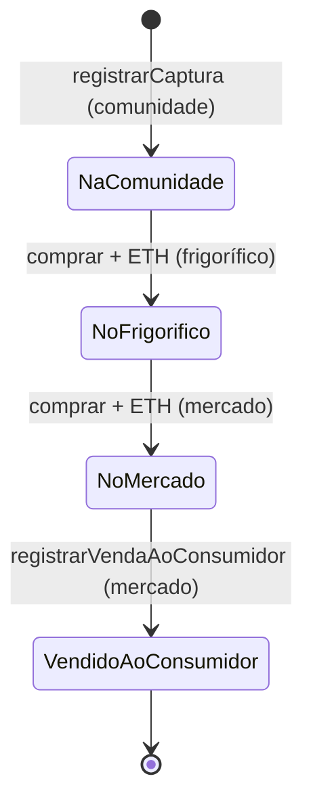

# 🐟 Pirarucu Legal v2 · dApp na Ethereum

Rastreabilidade do **pirarucu de manejo** da Amazônia com um **contrato inteligente em Solidity** na rede de teste **Sepolia**, com frontend web em HTML, CSS, JavaScript e **Web3.js**, e assinatura das transações pela **MetaMask**.

> A versão 1 (blockchain local em Python) está em [`../v1`](../v1). A v2 mantém o mesmo fluxo (o fiscalizador autoriza a cota, a comunidade registra o peixe pelo lacre e ele segue para o frigorífico e o mercado) numa blockchain pública, e acrescenta o **pagamento em ETH** a cada passagem de dono.

| | |
|---|---|
| **dApp na Vercel** | https://pirarucu-legal.vercel.app |
| **Contrato na Sepolia** | [`0x54379BeFff83a3B314Fa560e0B0AAaac266D05ED`](https://sepolia.etherscan.io/address/0x54379BeFff83a3B314Fa560e0B0AAaac266D05ED) |
| **Vídeo de demonstração** | *(link)* |
| **Slides** | [`docs/slides.pdf`](docs/slides.pdf) |

---

## 1. Tema e problema

O pirarucu (*Arapaima gigas*) vendido sem comprovação de origem continua aparecendo no Amazonas. Ele concorre de forma desleal com o pirarucu de manejo das comunidades. Em 2024, por exemplo, o Ibama apreendeu 422 kg em Tefé sem comprovação de procedência. As fontes estão no [README da v1](../v1/README.md#1-o-problema).

No Amazonas, o manejo segue o **Decreto estadual nº 36.083/2015**, que exige:
- cota de no máximo **30% dos adultos contados**;
- tamanho mínimo de **1,50 m**;
- **lacre individual numerado** em cada peixe.

**A solução:** cada peixe ganha um registro na Ethereum, do lago ao mercado. O contrato confere as regras do manejo **antes** de aceitar qualquer operação, e qualquer pessoa consulta a origem pelo número do lacre.

### Atores

| Ator | O que faz |
|---|---|
| **Fiscalizador** (dono do contrato) | Cadastra os participantes e autoriza o manejo de cada comunidade a partir da contagem de adultos |
| **Comunidade** | Registra cada peixe pescado (lacre, tamanho, peso e lago) e vende ao frigorífico |
| **Frigorífico** | Compra da comunidade e vende ao mercado |
| **Mercado** | Compra do frigorífico e registra a venda ao consumidor |
| **Consumidor** | Consulta o lacre, sem precisar de carteira |

### Por que blockchain?

- **Vários participantes que não confiam totalmente uns nos outros.** Ninguém é dono do registro, nem o fiscalizador.
- **O histórico não pode ser apagado.** Cada operação vira uma transação e um evento públicos no Etherscan.
- **As regras valem igual para todos.** O contrato rejeita peixe pequeno, lacre repetido, cota estourada e venda fora de ordem, para qualquer conta.
- **O pagamento acompanha a posse.** O peixe só muda de dono quando o comprador paga o preço exato, na mesma transação.

## 2. Integrantes

| Nome | Papel | GitHub |
|---|---|---|
| *(nome)* | Desenvolvedor(a) do contrato | @… |
| *(nome)* | Desenvolvedor(a) frontend | @… |
| *(nome)* | Integração Web3 | @… |
| *(nome)* | Documentação e QA | @… |

O contrato da v2 segue o fluxo da v1 e se limita ao essencial: cadastro, cota, captura por lacre e venda pela cadeia com pagamento em ETH. A equipe chegou a ter versões com mais recursos (fiscalizadores adicionais, suspensão de contas, apreensão e cadeia do frio), que ficaram de fora para manter o contrato simples. Elas estão em *Melhorias futuras*.

## 3. Deploy

| Item | Valor |
|---|---|
| Rede | Ethereum Sepolia (Chain ID 11155111 · `0xaa36a7`) |
| Endereço do contrato | `0x54379BeFff83a3B314Fa560e0B0AAaac266D05ED` |
| Fiscalizador (conta do deploy) | `0x272cbf7a1f66c6681db0d6b2ba2b153d8af4c550` |
| Hash da transação de deploy | [`0x2e7df03193de07498a37d6c8a4f38519cd684e5409032752571d33c17ec36a1b`](https://sepolia.etherscan.io/tx/0x2e7df03193de07498a37d6c8a4f38519cd684e5409032752571d33c17ec36a1b) |
| Bloco | `12148615` |
| Gas do deploy | 13.274.570 |
| Etherscan | https://sepolia.etherscan.io/address/0x54379BeFff83a3B314Fa560e0B0AAaac266D05ED |
| Compilador | Solidity 0.8.24 (Remix), otimizador ligado com 200 runs |
| Verificado no Etherscan | sim (Similar Match: o Etherscan reconheceu o mesmo código já verificado) · [código-fonte](https://sepolia.etherscan.io/address/0x54379BeFff83a3B314Fa560e0B0AAaac266D05ED#code) |

## 4. Arquitetura

```
┌───────────────────────────┐    Web3.js 4.x     ┌──────────────┐   assina   ┌────────────────────────────┐
│ Frontend (Vercel)         │ ── .call() ──────► │  MetaMask    │ ─────────► │ Sepolia                    │
│ index.html · style.css    │ ── .send() ──────► │  (carteira)  │            │ contrato PirarucuLegal.sol │
│ app.js · contrato.js (ABI)│ ◄─ eventos ─────── │              │ ◄───────── │ estado + eventos           │
└───────────────────────────┘                    └──────────────┘            └────────────────────────────┘
          │ sem carteira: leitura por RPC público (ethereum-sepolia-rpc.publicnode.com)
```

### Diagrama de estados do peixe (`enum Etapa`)



Em `NaComunidade` e em `NoFrigorifico`, o dono põe o peixe à venda com `colocarAVenda`. Chamar de novo troca o preço.

### Pagamento direto ao vendedor

Em `comprar`, o comprador envia o preço exato em ETH (`msg.value`), e o contrato repassa o valor **na mesma transação** para o vendedor, por um `address payable`. A função segue checks-effects-interactions: primeiro confere tudo (está à venda, papel certo, valor exato), depois atualiza o estado (novo dono, etapa, preço zerado, evento) e só no fim faz a transferência. Se o envio falhar, a compra inteira é desfeita (`FalhaNoPagamento`). Nenhum ETH fica guardado no contrato, e ele não tem `receive`/`fallback`, então ETH enviado direto é recusado.

O evento `PeixeVendido` traz a `diferenca` (`int256`) entre o preço de venda e o que o vendedor tinha pago. Ela é negativa quando alguém vende com prejuízo.

## 5. Funções do contrato

### Escrita (transações)

| Função | Quem pode chamar | O que faz | Evento | Erros possíveis |
|---|---|---|---|---|
| `cadastrarParticipante(conta, papel, nome)` | Fiscalizador | Cadastra comunidade, frigorífico ou mercado. O papel não pode ser trocado depois | `ParticipanteCadastrado` | `ApenasFiscalizador`, `ParticipanteJaCadastrado`, require (conta, papel, nome) |
| `autorizarManejo(comunidade, adultosContados)` | Fiscalizador | Define a cota como 30% dos adultos contados | `ManejoAutorizado` | `ApenasFiscalizador`, `PapelInvalido`, `CotaMenorQueCapturados`, require (cota zero) |
| `registrarCaptura(lacre, comprimentoCm, pesoGramas, local)` | Comunidade autorizada | Registra o peixe e consome 1 da cota | `PeixeRegistrado` | `PapelInvalido`, `ComunidadeNaoAutorizada`, `CotaEsgotada`, `LacreInvalido`, `LacreJaUsado`, `TamanhoForaDaFaixa`, `PesoInvalido` |
| `colocarAVenda(id, precoWei)` | Dono do peixe | Põe à venda para a próxima etapa (ou troca o preço) | `PeixeAVenda` | `PeixeInexistente`, `NaoEDonoDoPeixe`, `PeixeNaoNegociavel`, require (preço zero) |
| `comprar(id)` **payable** | Próximo papel da cadeia | Paga o preço exato, vira dono, avança a etapa e repassa o ETH ao vendedor | `PeixeVendido` | `PeixeInexistente`, `PeixeNaoEstaAVenda`, `PapelInvalido`, `ValorIncorreto`, `FalhaNoPagamento` |
| `registrarVendaAoConsumidor(id)` | Mercado dono do peixe | Fim da cadeia | `VendidoAoConsumidor` | `PeixeInexistente`, `NaoEDonoDoPeixe`, `EtapaInvalida` |

### Leitura (view / pure, sem gas)

`totalPeixes()`, `consultarPorLacre(lacre)`, `listarPeixes(inicio, quantidade)` (no máximo 50 por chamada), `calcularCota(adultos)`, `hashDoLacre(lacre)` e os getters públicos `fiscalizador`, `participantes`, `cotas`, `totalNegociadoWei` e as constantes.

**Unidades:** o comprimento vai em centímetros e o peso em gramas, porque a EVM não tem casas decimais. O frontend converte de metros e quilos.

## 6. Tabela de recursos

As linhas se referem a [`contracts/PirarucuLegal.sol`](contracts/PirarucuLegal.sol). Cada grupo está marcado no código com `// [Recurso: …]`, e as funções principais têm NatSpec (`@notice`, `@param`).

| Grupo | Onde (linhas / funções) | Por que foi usado |
|---|---|---|
| **TiposDeDados** | L59-80: `address immutable fiscalizador` (L61), constantes `uint256` (tamanho mínimo, percentual da cota, limite de página) e `uint256 totalNegociadoWei` (L80). L286: `int256 diferenca` em `comprar`. L233: `bytes32` (chave do lacre). L297: `address payable` no pagamento ao vendedor. L387: `bool` na validação do lacre. `string` em `lacre`, `local` e `nome` | O fiscalizador é `immutable` porque é definido no deploy e nunca muda. As regras do decreto são `constant`, sem custo de storage. A diferença da venda é **int** porque pode ser negativa (venda com prejuízo). O lacre vira `bytes32` (hash) para servir de chave única num mapping. O `address payable` é exigido para enviar ETH |
| **Funcoes** | `constructor` (L171). **external**: `cadastrarParticipante` (L180), `autorizarManejo` (L200), `registrarCaptura` (L220), `colocarAVenda` (L258), `comprar` (L274), `registrarVendaAoConsumidor` (L304). **public pure**: `calcularCota` (L348), `hashDoLacre` (L354), chamadas pelo próprio contrato. **internal**: `_validarMedidas` (L360), `_exigirPapel` (L368). **private**: `_textoValido` (L375), `_validarLacre` (L381), `_proximoPapel` (L394). **view**: `totalPeixes`, `consultarPorLacre`, `listarPeixes` (L315-344). **payable**: `comprar` (L274) | `external` nas funções chamadas só de fora, porque é mais barato com `calldata`. `public` onde o contrato também chama a função. `internal` e `private` separam a validação da regra de negócio. `payable` só onde entra ETH |
| **EstruturasDeControle** | `require` em `cadastrarParticipante` (L185-188), `autorizarManejo` (L204), `registrarCaptura` (L237) e `colocarAVenda` (L261). `if` + `revert` em todo o contrato. `if/else if/else` em `_proximoPapel` (L394). Laço `for` limitado a 50 em `listarPeixes` (L340) e a 20 em `_validarLacre` (L384). Checks-effects-interactions em `comprar` (L277-299) | `require` para validações simples de entrada, e `if`/`revert` com erro personalizado nas regras de negócio. Os laços têm limite fixo para o gas nunca crescer sem controle |
| **ArraysEMappings** | L82-93: `Peixe[] peixes` (array dinâmico), `mapping(bytes32 => uint256)` lacre → id (simples), `participantes` e `cotas` (mapping → struct) | O array permite listar e paginar os peixes. Os mappings dão acesso O(1) por endereço e por lacre |
| **StructsEEnums** | L14-57: `struct Peixe` (11 campos), `Participante`, `Cota`. `enum Etapa` (máquina de estados) e `enum Papel` | O struct agrupa os dados do peixe. O `enum Etapa` modela o diagrama de estados, e o `enum Papel` define o controle de acesso por papel |
| **Modificadores** | L136-167: `apenasFiscalizador` (dono), `apenasPapel(Papel)` **com parâmetro**, `peixeExiste(id)`, `apenasDonoDoPeixe(id)`, `noEstado(id, Etapa)` **com parâmetro** | Tiram as verificações repetidas de dentro das funções e concentram o controle de acesso |
| **EventosEErros** | L95-134: 6 eventos com `indexed` (`id`, `comunidade`, `vendedor`, `comprador`…) e 18 erros personalizados com parâmetros (`CotaEsgotada(capturados, limite)`, `ValorIncorreto(esperado, enviado)`, `FalhaNoPagamento(vendedor, valor)`…), além dos `require` | Os eventos formam o histórico que o frontend lê com `getPastEvents`, e o `indexed` permite filtrar por peixe ou conta. Os erros personalizados custam menos gas que strings e trazem os valores para o frontend montar mensagens claras |

### Segurança

- **Controle de acesso:** fiscalizador/dono (`apenasFiscalizador`), papéis (`apenasPapel`) e dono do peixe (`apenasDonoDoPeixe`). Um papel não pode ser trocado depois do cadastro, e o fiscalizador não pode ter outro papel.
- **Checks-effects-interactions:** em `comprar`, o estado é atualizado antes da transferência de ETH ao vendedor. Se ele tentar reentrar, o peixe já não está à venda.
- **Valor exato:** `comprar` exige `msg.value == preco`, então não sobra troco preso no contrato.
- **Falha no envio desfaz tudo:** se o vendedor não puder receber, `FalhaNoPagamento` reverte a compra.
- **Sem `receive`/`fallback`:** ETH enviado por engano é recusado.
- **Laços com limite fixo:** nenhuma função percorre todos os peixes.
- **Overflow:** checado automaticamente pelo Solidity 0.8.

### Conceitos do frontend (Web3.js)

As linhas se referem a [`frontend/app.js`](frontend/app.js), que está dividido em 9 seções numeradas, cada uma com um comentário que explica o conceito usado.

| Conceito | Onde | Como foi feito |
|---|---|---|
| Endereço + ABI do contrato | [`contrato.js`](frontend/contrato.js) e seção 1 (L17) | `CONTRATO.endereco`, `CONTRATO.abi` e `blocoDeploy` num arquivo separado da lógica |
| Provider injetado (`window.ethereum`) | Seção 2: `iniciar()` (L73), `configurarProvedores()` (L110) | Reconexão silenciosa com `eth_accounts` (L92). Sem MetaMask, a leitura usa um RPC público |
| Conectar carteira | Seção 3: `conectar()` (L173) | `eth_requestAccounts`, que abre o popup da MetaMask |
| Conferir e trocar a rede | `verificarRede()` (L188), `trocarParaSepolia()` (L198) | `eth_chainId`, `wallet_switchEthereumChain` e, se a rede não estiver cadastrada (4902), `wallet_addEthereumChain` |
| Reação a troca de conta/rede | `aoTrocarConta()` (L229), `aoTrocarRede()` (L239), ouvintes na L89 | `accountsChanged` e `chainChanged` atualizam o estado e a tela **sem recarregar a página** |
| Troca rápida entre contas | `definirContas()` (L247), `trocarConta()` (L254), `conectarMaisContas()` (L278), `renderizarContas()` (L732) | `eth_accounts` devolve todas as contas autorizadas; o menu suspenso da conta escolhe qual vai no `from` das transações, sem trocar de conta na MetaMask. `wallet_requestPermissions` inclui mais contas |
| Leitura gratuita com `.call()` | Seção 4: `atualizarPapel()` (L414), `carregarResumo()` (L432), `carregarPeixes()` (L446) | `Promise.all` em paralelo, `uint256` tratado como `BigInt` e leitura paginada de `listarPeixes` |
| Consulta de logs com `getPastEvents` | Seção 5: `carregarEventos()` (L495) | `allEvents` a partir do bloco do deploy, em lotes de 5.000 blocos, buscando só os blocos novos a cada atualização |
| Transação assinada com `.send()` | Seção 6: `enviar()` (L564) | Simulação com `.call()` antes (L566), `estimateGas` + 20% de folga, `.on("transactionHash")` (L579) e estados *aguardando assinatura → pendente → confirmada/falhou* |
| Envio de ETH (`value`) | `enviar()` (L567), botão de compra (L891) | `comprar(id)` é `payable` e recebe o preço exato em wei no campo `value` |
| Tela conforme o papel da conta | Seção 7: `ePrincipal()` (L688), `renderizarPaineis()` (L762), `acoesDoPeixe()` (L869) | O painel administrativo só aparece para o dono do contrato, e cada conta só vê os botões do seu papel. O contrato confere as mesmas regras de novo |
| Tratamento de erros | Seção 8: `montarSeletoresDeErro()` (L1001), `decodificarErro()` (L1033), `mensagemDeErro()` (L1053) | Rejeição (4001), erros personalizados decodificados pelo seletor da ABI, `require` (`Error(string)`), saldo insuficiente e pedido pendente (-32002) |
| Proteção contra XSS | Seção 9: `el()` (L1081) | A tela é montada com `textContent`, nunca `innerHTML`, porque dados on-chain foram digitados por usuários |

## 7. Como usar

### URL pública

Abra https://pirarucu-legal.vercel.app num navegador com a MetaMask.

### Configurar a MetaMask na Sepolia

1. Instale a extensão da MetaMask e crie uma carteira **só para testes**.
2. Ative as redes de teste: *Configurações > Avançado > Mostrar redes de teste*. Outra opção: clique em **Trocar para Sepolia** na própria dApp, que faz a troca (e adiciona a rede, se preciso).
3. Pegue SepoliaETH num faucet, como o [Google Cloud Web3 Faucet](https://cloud.google.com/application/web3/faucet/ethereum/sepolia) ou o [faucet da Alchemy](https://www.alchemy.com/faucets/ethereum-sepolia).
4. Para a demonstração, deixe **4 contas** com SepoliaETH: fiscalizador (a do deploy), comunidade, frigorífico e mercado. Na dApp, use **Conectar outras contas** (no menu da conta, canto superior direito) para autorizar as quatro e trocar entre elas pelo mesmo menu.

> Nunca use uma carteira com fundos reais e nunca publique a frase de recuperação nem a chave privada.

### Rodar o frontend localmente

O frontend é estático. Sirva a pasta `frontend/` por HTTP, porque a MetaMask não injeta em `file://`:

```bash
cd v2/frontend
python3 -m http.server 8080   # abra http://localhost:8080
```

### Deploy do contrato (Remix)

1. Abra o [Remix](https://remix.ethereum.org) e crie `PirarucuLegal.sol` com o conteúdo de `contracts/PirarucuLegal.sol`.
2. Na aba **Solidity Compiler**, escolha a versão **0.8.24**, ative **Optimization** com **200 runs** (em *Advanced Configurations*) e compile. Essa configuração é a que deve ser repetida na verificação do Etherscan.
3. Na aba **Deploy & Run**, escolha *Injected Provider - MetaMask*, confira se a MetaMask está na Sepolia e clique em **Deploy** com a conta que será o fiscalizador.
4. Copie o endereço do contrato e o número do bloco do deploy (aparece no Etherscan) para `frontend/contrato.js` (`endereco` e `blocoDeploy`).
5. (Opcional) Verifique o código no Etherscan: *Contract > Verify and Publish*, com o compilador `v0.8.24`, licença MIT, otimização igual à usada no Remix e o arquivo `.sol` único.

### Deploy do frontend (Vercel)

1. Na Vercel, faça *Add New > Project* e importe este repositório do GitHub.
2. Em **Root Directory**, escolha `v2/frontend`. O *Framework Preset* é **Other**, sem comando de build.
3. Clique em *Deploy*. A cada `git push`, a Vercel publica de novo.

### Testes automatizados do contrato (opcional)

Além dos testes manuais no Remix, `testes/test_contrato.py` roda 27 testes numa EVM local, inclusive o caso em que o pagamento ao vendedor falha e a compra é desfeita, sem gastar SepoliaETH:

```bash
cd v2
pip install "web3[tester]" py-solc-x pytest
pytest testes/ -v
```

## 8. Roteiro de teste

Use o contrato já implantado, pela URL da Vercel. Cada passo indica a conta ativa na MetaMask.

| # | Conta | Ação | Resultado esperado |
|---|---|---|---|
| 1 | qualquer | Abrir a dApp e clicar em **Conectar carteira** | Endereço, saldo em ETH e papel aparecem no topo |
| 2 | qualquer | Trocar a MetaMask para outra rede | Aviso de rede errada e botão **Trocar para Sepolia** |
| 3 | Fiscalizador | No **Painel do fiscalizador**, cadastrar a comunidade, o frigorífico e o mercado | Transação *pendente* → *confirmada*, com link para o Etherscan e evento `ParticipanteCadastrado` na lista |
| 4 | Fiscalizador | Cadastrar de novo a conta da comunidade com outro papel | **Erro tratado:** "já está cadastrada, e o papel não pode ser trocado" |
| 5 | Fiscalizador | Autorizar o manejo da comunidade com 10 adultos | A prévia mostra cota de 3, e aparece o evento `ManejoAutorizado` |
| 6 | Comunidade | Trocar de conta (menu da conta no topo do site, ou na MetaMask) | A tela muda sozinha: some o painel do fiscalizador e aparece **Registrar captura** com a cota |
| 7 | Comunidade | Registrar o lacre `AM-000101`, 1.92 m, 74.5 kg, Lago Mamirauá | O peixe #0 aparece em **Peixes** como *Na comunidade* |
| 8 | Comunidade | Registrar um peixe de 1.40 m | **Erro tratado:** "está fora da faixa permitida (1,50 m a 3,00 m)" |
| 9 | Comunidade | No peixe #0, **Pôr à venda** por 0.001 ETH e **rejeitar** na MetaMask | **Erro tratado:** "Você rejeitou a transação" |
| 10 | Comunidade | Repetir e confirmar | Evento `PeixeAVenda` |
| 11 | Frigorífico | **Comprar por 0,001 ETH** | **Transação com ETH (value).** O peixe vai para *No frigorífico*, e o saldo da comunidade sobe 0,001 ETH na hora |
| 12 | Frigorífico | Pôr à venda por 0.0008 ETH | Evento `PeixeAVenda` |
| 13 | Mercado | Filtrar **À venda para mim** e comprar | O evento `PeixeVendido` mostra a diferença **negativa** (−0,0002 ETH) para o frigorífico |
| 14 | Mercado | **Registrar venda ao consumidor** | O peixe vai para *Vendido ao consumidor* |
| 15 | sem carteira | Em **Consultar lacre**, buscar `AM-000101` | Dados do peixe e a linha do tempo completa, com links para o Etherscan |

### Custos de gas observados

Valores medidos numa EVM local (eth-tester), com o otimizador ligado. A Sepolia segue regras de gas mais novas e cobra mais (o deploy real usou 13.274.570 de gas, contra ~1,88 milhão aqui), então use a tabela para comparar as operações entre si, não como custo exato na rede.

| Operação | Gas |
|---|---|
| Deploy | ~1.880.000 |
| `cadastrarParticipante` | ~71.000 |
| `autorizarManejo` | ~38.000 ao atualizar a cota (a primeira autorização grava mais campos e custa mais) |
| `registrarCaptura` | ~259.000 (grava 2 strings e o struct) |
| `colocarAVenda` | ~53.000 |
| `comprar` | ~111.000 (inclui o envio de ETH ao vendedor) |
| `registrarVendaAoConsumidor` | ~33.000 |

## 9. Limitações conhecidas e melhorias futuras

- **Fiscalizador único e imutável:** se a chave dele for perdida, ninguém mais cadastra participantes nem autoriza o manejo. Uma melhoria seria usar uma multisig ou o `AccessControl` da OpenZeppelin, com fiscalizadores adicionais.
- **Recursos que ficaram de fora para simplificar:** suspensão de participantes, apreensão de peixes irregulares, cancelamento de venda e registro da cadeia do frio (temperatura no frigorífico).
- **Os dados ficam públicos:** nomes e locais ficam visíveis na blockchain para sempre. Por isso não guardamos CPF nem dados pessoais dos pescadores (LGPD).
- **O contrato confia no que é digitado:** ele confere se o peixe tem 1,50 m, mas não mede o peixe. A blockchain garante que o registro não muda, não que ele é verdadeiro. A integração com balanças e leitores de lacre (QR/NFC) ficaria para depois.
- **Venda ao consumidor sem pagamento on-chain:** o consumidor paga fora da blockchain, e o contrato só registra a venda.
- **Listagem:** o frontend busca todos os peixes em páginas de 50, o que é suficiente para a demonstração. Em produção, o caminho seria um indexador (The Graph, por exemplo).
- **Histórico de eventos:** é lido a partir do bloco do deploy, em lotes de 5.000 blocos. RPCs públicos podem limitar a busca.

## 10. Declaração de uso de ferramentas de IA

*(preencher pela equipe)*

## Estrutura do repositório

```
v2/
├── contracts/
│   └── PirarucuLegal.sol      # contrato (recursos marcados e NatSpec)
├── frontend/
│   ├── index.html
│   ├── style.css
│   ├── app.js                 # conexão, chamadas, transações e eventos
│   ├── constantes.js          # rede Sepolia, textos dos enums e limites
│   └── contrato.js            # ABI + endereço
├── testes/
│   └── test_contrato.py       # testes automatizados do contrato (opcional)
├── docs/
│   ├── slides.pdf
│   └── prints/                # capturas do Remix, MetaMask e Etherscan
└── README.md
```
